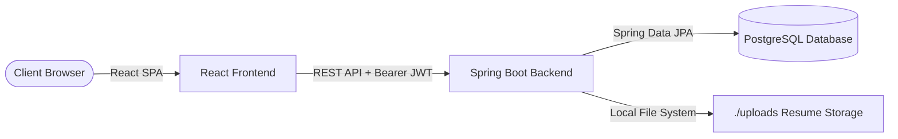

# 🚀 JobPortal Malawi — Full-Stack Job Search Engine

JobPortal Malawi is a production-ready, full-stack web application designed to connect talented job seekers with leading employers across Malawi. The platform features role-based access control, real-time application metrics, dynamic job search filtering, and secure JWT-based authentication.

Developed with a high-performance **Spring Boot** backend, a responsive **React** frontend, and a robust **PostgreSQL** relational database.

---

## 🌟 Key Features

*   **Role-Based Access Control (RBAC)**: Distinct registration and dashboards for **Job Seekers**, **Employers**, and **System Admins**.
*   **Secure Authentication**: JWT-based stateless authentication with token interceptors on the frontend.
*   **Dynamic Job Board**: Custom search filters for keying in keywords, specific locations (e.g., Lilongwe, Blantyre), and employment types (Full-Time, Part-Time, Contract).
*   **Employer Dashboards**: Analytical metrics tracking total jobs posted and active listings in real-time.
*   **Admin Panel**: Exclusive access to moderate job approvals and manage active user records.
*   **File Storage**: Seamless upload profiles and resumés (PDF and Word formats).

---

## 🛠️ Technology Stack

### Backend
*   **Framework**: Spring Boot 3.1.2 (Java 17)
*   **Security**: Spring Security & JWT (Json Web Token)
*   **Persistence**: Spring Data JPA & Hibernate
*   **Database**: PostgreSQL (Production) / H2 (Development & Testing)
*   **Validation**: Jakarta Validation API

### Frontend
*   **Library**: React (v18)
*   **Styling**: Tailwind CSS & Material-UI (MUI v5)
*   **API Client**: Axios with custom interceptors for token injection
*   **Notifications**: React-Toastify

---

## 📐 System Architecture



---

## 🚀 Getting Started

### 📋 Prerequisites
*   **Java**: JDK 17 or higher
*   **Node.js**: v18.x or higher
*   **npm**: v9.x or higher
*   **PostgreSQL**: v14 or higher

---

### ⚙️ Backend Setup & Launch

1.  **Configure Environment Variables**:
    Set up local environment variables or update `src/main/resources/application.properties` with your PostgreSQL credentials:
    ```properties
    spring.datasource.url=jdbc:postgresql://localhost:5432/jobportal
    spring.datasource.username=your_postgres_username
    spring.datasource.password=your_postgres_password
    jwt.secret=your_super_secure_base64_jwt_secret_key
    ```

2.  **Initialize Database**:
    Ensure a PostgreSQL database named `jobportal` exists:
    ```sql
    CREATE DATABASE jobportal;
    ```

3.  **Compile & Run**:
    Navigate to the root directory and use the Maven wrapper to boot the server:
    ```bash
    # Windows
    mvnw.cmd spring-boot:run

    # Linux / macOS
    ./mvnw spring-boot:run
    ```
    The backend server will launch on **`http://localhost:8091`**.

---

### 💻 Frontend Setup & Launch

1.  **Navigate to Frontend Directory**:
    ```bash
    cd jobportal-frontend
    ```

2.  **Install Dependencies**:
    ```bash
    npm install
    ```

3.  **Start the Development Server**:
    ```bash
    npm start
    ```
    The frontend client will boot and open automatically at **`http://localhost:3000`**.

---

## 🔒 Security & API Best Practices

*   **API Base URL**: Configured in `src/services/api.js`.
*   **Authorization Interceptor**: The frontend uses Axios interceptors to retrieve the JWT token from `localStorage` and automatically append it to all outbound HTTP requests inside the `Authorization: Bearer <token>` header.
*   **Endpoint Controls**: Role restrictions are enforced at both database and router levels. Backend endpoints utilize `@PreAuthorize("hasAuthority('ROLE_EMPLOYER')")` or similar constraints to prevent security breaches.

---

## 📝 License
This project is licensed under the MIT License - see the [LICENSE](LICENSE) file for details.
